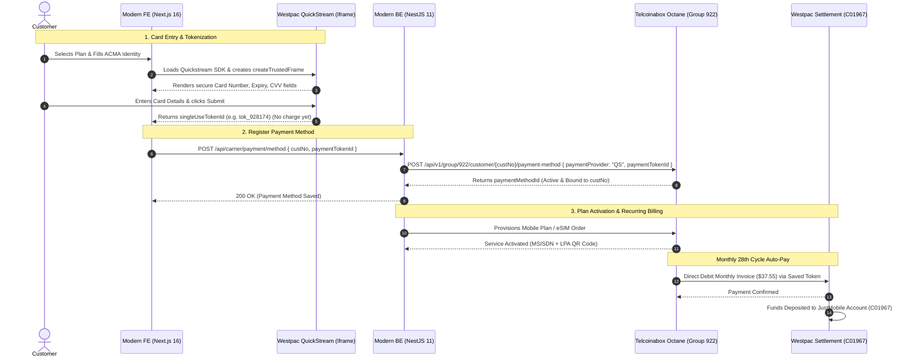

# Westpac QuickStream Payment Architecture & Telcoinabox Integration

**Document Version:** 1.0  
**Classification:** Technical Architecture Reference & Implementation Specification  
**Status:** Documented for Client Review & Confirmation  

---

## 1. Executive Summary

This document specifies the end-to-end payment processing architecture for JustMobile, based on the verified working implementation discovered in the legacy repositories (`bele-backend` and `justmobile`).

Instead of introducing a third-party gateway like Stripe (which would require separate recurring billing schedulers and external reconciliation), JustMobile leverages **Telcoinabox's native wholesale payment provider: Westpac QuickStream (Qvalent)**.

This native gateway allows:
1. **PCI-DSS Level 1 Compliant Card Capture:** Credit card data is entered into a secure Westpac iframe (`createTrustedFrame`). No raw card numbers or CVVs touch JustMobile servers or client code.
2. **Direct Wholesale Ledger Binding:** The generated single-use token is registered directly with Telcoinabox Octane under the customer's Wholesale Customer ID (`custNo`).
3. **Automated Monthly Recurring Auto-Pay:** Telcoinabox's billing engine automatically charges the saved card on the 28th of every calendar month for active plans.
4. **Existing Production Credentials:** All API keys and merchant configurations are already provisioned and active.

---

## 2. Key Identifiers & Routing ("Where Does the Money Go?")

When a customer pays, two distinct layers route the funds and record the billing:

### A. Bank Account Settlement Destination
- **Merchant Gateway:** Westpac QuickStream / Qvalent
- **Supplier Business Code:** `C01967` (and publishable supplier code `TIABREST`)
- **Clearing Mechanism:** In Westpac's clearing system, `C01967` is linked to JustMobile's / Telcoinabox's registered Australian business bank account (BSB & Account Number).
- **Settlement:** When transactions execute with `supplierBusinessCode: C01967`, Westpac's banking network clears the funds directly into that bank account.

### B. Telco Subscriber Ledger & Invoice Matching
- **Wholesale Group:** `groupNo: 922` (JustMobile's Wholesale Account in Telcoinabox Octane).
- **Subscriber Account:** `custNo` (e.g., `551059` created for Syed Yaseen Jamal).
- **Ledger Update:** When the card token is registered at `/api/v1/group/922/customer/{custNo}/payment-method`, Telcoinabox binds the card to that subscriber. Invoices generated on the 28th are automatically debited against this card and marked as `PAID`.

---

## 3. How the Iframe Handles Payments ("Is the Amount in the Iframe?")

**Answer: No. The iframe does NOT take or receive the payment amount.**

### Why the Iframe Only Performs Tokenization
1. **PCI-DSS Scope Reduction:** The Westpac `createTrustedFrame` iframe only captures Cardholder Name, Card Number, Expiry Date, and CVV.
2. **Anti-Tampering Security:** Monetary amounts must never be exposed to client-side HTML or JavaScript, as users could modify the DOM to charge arbitrary amounts (e.g. $0.01 instead of $37.55).
3. **Token on File Architecture:** When tokenizing a card for recurring telco subscriptions, $0.00 is charged at the moment of iframe submission. Westpac verifies card validity and returns a `singleUseTokenId`.

### Where the Amount IS Handled
The monetary amount is strictly defined and dispatched by the **backend server**:
- **For immediate plan fee or outright charge:** Backend calls Westpac REST API (`POST https://api.quickstream.support.qvalent.com/rest/v1/transactions`) passing `principalAmount: 37.55` and `singleUseTokenId`.
- **For monthly recurring billing:** Telcoinabox's billing engine automatically calculates the customer's plan fee on the 28th and executes the debit against the token on file.

---

## 4. End-to-End Sequence Diagram

---

## 5. Existing Production Credentials (From `bele-backend/.env`)

These credentials are confirmed from the working legacy deployment:

| Variable | Value | Description |
| :--- | :--- | :--- |
| `groupNo` | `922` | JustMobile Wholesale Group ID in Octane |
| `quickstreamApiKey` | `C01967_SEC_cjpde5i6crnxs794ek6nq7ybi3qs3nqdp2w37mzwecbaktfm6k2kjequ4rt4` | Westpac QuickStream Backend Secret |
| `publishableApiKey` | `TIAB_PUB_sawvcp2cgmdfiyehcysqpe6qh6ajk4pbhgasz3t9tetu7t3r9p767ygsmmxm` | Westpac QuickStream Frontend Public Key |
| `supplierBusinessCode` | `TIABREST` / `C01967` | Westpac Merchant Settlement Account Code |
| `quickstreamCdnUrl` | `https://api.quickstream.westpac.com.au/rest/v1/quickstream-api-1.0.min.js` | Official Westpac JS SDK |

---

## 6. Implementation Scope for Modern System

When approved, implementation requires:

1. **Backend (`just-mobile-development-BE`):**
   - Add `payment.controller.ts` & `payment.service.ts` into `src/modules/payment`.
   - Wire `POST /api/carrier/payment/method` to pass the token to Telcoinabox.
   - Wire optional `POST /api/carrier/payment/process` for immediate one-time charges.
2. **Frontend (`just-mobile-development-FE`):**
   - Embed `PaymentStep` into [`OrderFlowModal.tsx`](file:///d:/Just-Mobile-Development/just-mobile-development-FE/src/components/OrderFlowModal.tsx) after ACMA verification.
   - Add "Update Card on File" in [`/account`](file:///d:/Just-Mobile-Development/just-mobile-development-FE/src/app/account/page.tsx).
