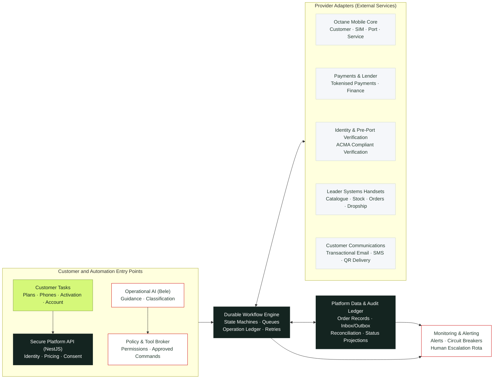

# JustMobile Master Architecture & Development Context Guide

**Version:** 1.0 — Unified Technical Baseline  
**Date:** 29 October 2026  
**Classification:** Internal Engineering & Architecture Reference  
**Design Baseline:** Redesign checkpoint `beced0d6` (OmniSuiteAI / JustMobile Handoff v1.0)  
**Repositories:**
- Frontend: `just-mobile-development-FE` (Next.js 16+, TypeScript, Vanilla CSS / Brand Tokens)
- Backend: `just-mobile-development-BE` (NestJS 11+, TypeScript, Modular Architecture, Durable Workflows)
- **Active Task Tracker & Handover:** See [`REMAINING_TASKS.md`](file:///d:/Just-Mobile-Development/REMAINING_TASKS.md) for the active list of remaining tasks and daily execution priorities.

---

## 1. Executive Summary & Product Vision

JustMobile is built as a premier, high-reliability Australian telecommunications challenger brand. Its customer proposition is:
> **"Less telco. More you."**  
> *"A little less telco. A lot more you."*

### Key Strategic Directives
1. **Move AI Out of the Spotlight:**
   - Previous legacy positioning placed "Australia's first AI-powered eSIM provider" and conversational chat front-and-centre.
   - The new platform transitions to **structured, resumable customer task flows** (Plans, Phones, Coverage, Help, My Account).
   - "Bele" (the AI assistant) is repositioned as a quiet, operational helper within support and task guidance—never the sole gateway to commerce, porting, activation, or complaints.
2. **Deterministic, Zero-Touch Operational Core:**
   - Target: Routine, eligible journeys (new eSIM activation, number port-in, outright handset purchases) complete without manual intervention.
   - External carriers, banks, identity providers, and telco aggregators (Octane) fail regularly. The architecture must handle failures deterministically rather than assuming 100% uptime.
   - High-risk operations (disputes, fraud signals, failed identity checks, customer complaints, unlawful port attempts) must follow accountable, human-accessible escalation pathways compliant with Australian ACMA and TIO regulations.
3. **No Direct Browser-to-Core Connections:**
   - The browser connects **only** to the secure JustMobile API.
   - It never speaks directly to the Octane telco core, Leader Systems supplier portal, or sensitive partner gateways.

---

## 2. High-Level Operations Architecture



### Architectural Principles
- **AI Tool Execution Rule:**  
  `AI suggestion → Policy & Permission Check → Typed Command → Deterministic Workflow → Verified Provider Result`
- **Data Ownership & Source of Truth:**
  - **JustMobile Platform:** Owns customer-facing orders, versioned quotes, consent evidence, provider references, and status projections.
  - **Octane (Telcoinabox):** Authoritative source for mobile service provisioning, SIM/eSIM resources, phone numbers, and network line state.
  - **Payment Provider (Westpac QuickStream / Telcoinabox Native):** Authoritative source for card tokenisation (via PCI Trusted Frame iframe, `supplierBusinessCode: C01967`), token registration in Octane (`paymentProvider: 'QS'`), and automated monthly 28th cycle direct debits. (See `docs/PAYMENT_ARCHITECTURE_WESTPAC_QUICKSTREAM.md`).
  - **Lender:** Authoritative source for credit decisions, finance contracts, and loan balances.
  - **Leader Systems:** Authoritative source for handset availability, wholesale cost, and dropship dispatch tracking.

---

## 3. Front-End Technical Guide & Design System

### 3.1 Technology Stack
- **Framework:** Next.js 16+ (App Router, TypeScript)
- **Styling:** Vanilla CSS with CSS Modules, CSS custom properties (design tokens), Zero Tailwind dependency
- **Fonts:** Manrope (Display/Headings) and Inter (Body/UI) variable fonts loaded locally with SIL Open Font Licences
- **Target Accessibility:** WCAG 2.2 AA compliant, full keyboard navigation, high contrast ratios, reduced motion support

### 3.2 Design Tokens & Visual Hierarchy
```css
:root {
  /* Brand Palette */
  --jm-ink: #142420;          /* Dominant dark shade: headings, navigation, primary buttons */
  --jm-lime: #D5F879;         /* Vibrant brand accent: highlights, badges, active states */
  --jm-paper: #FAFBF8;        /* Warm background canvas */
  --jm-text: #152420;         /* Primary text color */
  --jm-secondary: #F1F3ED;    /* Neutral card and section backgrounds */
  --jm-mutedText: #58615F;    /* Secondary captions, disclaimers */
  --jm-border: #DFE4DD;       /* Subtle card and input borders */
  --jm-focus: #547523;        /* Accessible keyboard focus outline */
  --jm-dotAccent: #789937;    /* Indicator dot accent */

  /* Typography */
  --jm-font-display: 'Manrope', system-ui, -apple-system, sans-serif;
  --jm-font-body: 'Inter', system-ui, -apple-system, sans-serif;

  /* Layout & Spacing */
  --jm-container-max: 1320px;
  --jm-gutter-desktop: 48px;
  --jm-gutter-tablet: 32px;
  --jm-gutter-mobile: 22px;
  --jm-section-spacing-desktop: 100px;
  --jm-section-spacing-mobile: 60px;

  /* Border Radii */
  --jm-radius-button: 7px;
  --jm-radius-card-sm: 12px;
  --jm-radius-card-md: 14px;
  --jm-radius-card-lg: 20px;
}
```

### 3.3 Critical Front-End Design Rules
1. **Contrast Rule for Lime:** `--jm-lime` (#D5F879) MUST always be paired with dark ink text (`#142420`). Never use white text on lime.
2. **Wordmark Rendering:** Always use the lowercase `justmobile.` wordmark with the four-part rounded brand mark. Do not use legacy uppercase or retired AI-orb assets.
3. **Price Clarity:**
   - All monetary figures must be computed and transmitted in **integer cents** (e.g. `$19.00` = `1900`).
   - Clearly separate mobile service subscription costs from handset hardware financing.
   - For instalment calculators (12, 24, 36 months with 0%, 25%, 50% upfront contributions), display the monthly instalment, upfront payment, and total aggregate cost side-by-side with required CIS / credit disclaimers.
4. **Resumable Task Flows:**
   - Every checkout, activation, and porting journey must be linkable and resumable via a persistent `order_id` or session token. If the user refreshes or switches devices, their state is preserved.
5. **No False Promises:**
   - Front-end copy must avoid unsupported superlatives: *"cheapest in Australia"*, *"instant activation"*, *"never fails"*, or retail network equivalence.
   - Polling displays must show realistic statuses: *"We're checking with the network..."* along with a last-checked timestamp.

### 3.4 Active Assets & Manifest
- **Handsets:**
  - `galaxy-s26-ultra-512gb-black.jpg` ($2,399 proposed RRP)
  - `galaxy-s26-256gb-black.jpg` ($1,499 proposed RRP)
  - `pixel-11-pro-256gb-obsidian.jpg` ($1,799 proposed RRP)
  - `galaxy-a56-128gb-enterprise-graphite.jpg` ($679 proposed RRP)
- **Hero & Lifestyle:**
  - `galaxy-s26-ultra-hero-cutout.png` (Flagship hero transparent cutout)
  - `australian-coast.jpeg` (Authentic Australian coastal backdrop)
- **Logos & Icons:**
  - Wordmark outlined SVGs: ink and light
  - Marks: ink, lime, white
  - Favicon (`favicon.ico`) & App Icon (`app-icon-512.png`)

---

## 4. Back-End Technical Guide & System Specifications

### 4.1 Technology Stack
- **Framework:** NestJS 11+ (TypeScript, Express/Fastify adapter)
- **Architecture:** Clean Hexagonal / Modular Architecture with Domain-Driven Design (DDD)
- **Workflow & Queue Engine:** Durable Operation Engine (BullMQ + Redis / DB-backed transactional outbox)
- **Database:** PostgreSQL with TypeORM / Prisma (migrations, schema constraints, audit log tables)
- **Validation & Serialization:** `class-validator`, `class-transformer`, schema validation on all inputs and external payloads

### 4.2 Module Structure (`src/`)
```
src/
├── app.module.ts                         # Root application module
├── main.ts                               # App bootstrap & global pipes
├── common/                               # Shared utilities, filters, decorators
│   ├── decorators/                       # Custom parameter & auth decorators
│   ├── filters/                          # Global exception filter (ACMA/security sanitization)
│   ├── guards/                           # AuthGuard, PolicyGuard, RateLimitGuard
│   ├── interceptors/                     # LoggingInterceptor (redacts PII/CVV/secrets)
│   └── types/                            # Event envelope, operation records
├── modules/
│   ├── auth/                             # User accounts, session management, MFA
│   ├── quotes/                           # Server-side pricing engine (integer cents, expiries)
│   ├── orders/                           # Order lifecycle, bundle coordination
│   ├── workflows/                        # Durable state machine orchestrator
│   │   ├── activation.workflow.ts        # New number eSIM flow (11 states)
│   │   ├── port.workflow.ts              # Porting existing number flow (9 states)
│   │   ├── handset.workflow.ts           # Handset purchase & dropship flow (9 states)
│   │   └── ledger.service.ts             # Operation ledger & outbox/inbox manager
│   ├── adapters/                         # Provider-specific implementations
│   │   ├── octane/                       # Telcoinabox Octane SOAP/WSDL + JSON adapter
│   │   │   ├── octane-client.service.ts
│   │   │   ├── octane-customer.service.ts
│   │   │   ├── octane-order.service.ts
│   │   │   └── octane-polling.service.ts # Strictly 1 query / 30 mins per order
│   │   ├── leader/                       # Leader Systems handset dropship & catalog
│   │   ├── payment/                      # Stripe tokenized payments & webhooks
│   │   ├── finance/                      # Handset finance lender integration
│   │   ├── identity/                     # ACMA pre-port & postpaid/prepaid ID checks
│   │   └── communications/               # Postmark/Twilio transactional email/SMS & QR
│   ├── bele-ai/                          # Bele operational AI & policy broker
│   │   ├── bele.controller.ts
│   │   ├── bele.service.ts
│   │   └── policy-broker.service.ts      # Permission guards on AI-generated requests
│   └── reconciliation/                   # Periodic reconciliation jobs
```

### 4.3 Write Safety & Recovery Contract
1. **Persist Before Provider Write:**
   - Every external call must be preceded by an immutable `OperationRecord` inserted in state `pending`.
2. **Deterministic Deduplication:**
   - Use idempotency keys derived from `order_id` + `step_name` + `attempt_count`.
   - Never assume external provider references are idempotency keys unless confirmed in the contract.
3. **Ambiguous Timeout Handling (`outcome_unknown`):**
   - If an HTTP or SOAP request to Octane, Leader, or the Payment gateway times out, the local state is transitioned to `outcome_unknown`.
   - **Never blindly replay a write operation.** Instead, trigger an enquiry step using external correlation IDs to verify if the provider processed it before taking compensatory action.
4. **Rate Limits & Polling Budget:**
   - Octane published guidelines mandate **maximum 1 status query per order every 30 minutes**.
   - Second-by-second polling is strictly prohibited. The system schedules BullMQ delayed jobs at 30-minute intervals and exposes "last checked" timestamps to the user.

---

## 5. Workflows & State Machine Contracts

### 5.1 Local Workflows Defined

#### A. New Number eSIM Activation
```
[draft]
   ↓
[quote_accepted]
   ↓
[prerequisites_satisfied] (Identity & Payment gates passed)
   ↓
[octane_customer_linked] (Link or retrieve custNo)
   ↓
[number_reserved] (MSISDN pool reservation)
   ↓
[order_submitted] (Octane mobile order submitted)
   ↓
[provider_pending] (Awaiting telco network provisioning)
   ↓
[service_confirmed] (Active service evidence received)
   ↓
[profile_available] (eSIM SM-DP+ profile ready)
   ↓
[setup_delivered] (Secure QR code sent / displayed)
   ↓
[ready_to_use]
```

#### B. Port Existing Mobile Number
```
[draft]
   ↓
[consent_captured] (Explicit porting consent recorded)
   ↓
[rights_of_use_verified] (ACMA-mandated OTP / DOB / Account check)
   ↓
[details_validated] (Losing telco details validated)
   ↓
[port_submitted] (Octane port order submitted)
   ↓
[provider_pending] (Pending losing carrier acceptance)
   ↓
[cutover_pending] (Cutover scheduled by carrier)
   ↓
[service_confirmed] (Port completed & network service active)
   ↓
[complete]
```

#### C. Handset Purchase (Outright / Financed)
```
[draft]
   ↓
[quote_accepted]
   ↓
[prerequisites_satisfied] (Address validated, fraud check passed)
   ↓
[payment_or_finance_authorised] (Card pre-auth or lender contract signed)
   ↓
[supplier_accepted] (Leader Systems confirms SKU allocation)
   ↓
[capture_or_settlement_confirmed] (Payment captured / financed settled)
   ↓
[fulfilment_pending] (Sent to warehouse for packing)
   ↓
[shipped] (Tracking number received)
   ↓
[delivered] (Carrier confirmation)
```

#### D. Shared Exception States
- `action_required`: User input needed (e.g. incorrect losing account number).
- `provider_rejected`: Telco or supplier hard rejection.
- `outcome_unknown`: Network timeout during write; enquiry required.
- `security_hold`: Potential fraud, failed MFA, or ACMA verification block.
- `provider_unavailable`: Upstream provider outage; circuit breaker engaged.
- `cancel_requested` / `cancelled`: Lawful cancellation.
- `refund_pending` / `refunded`: Compensatory financial reversal.
- `escalated`: Routed to customer support or compliance personnel.

### 5.2 Event Envelope Specification
All asynchronous and domain events conform to this JSON schema:
```json
{
  "event_id": "uuid-v4",
  "event_type": "port.rights_of_use_verified",
  "schema_version": "1.0",
  "occurred_at": "2026-10-29T12:00:00.000Z",
  "received_at": "2026-10-29T12:00:00.050Z",
  "source": "justmobile.identity-service",
  "aggregate_id": "ord_987654321",
  "correlation_id": "corr_123456789",
  "causation_id": "evt_previous_id",
  "provider_reference": "OCT_ORD_9988",
  "payload": {
    "verified_phone_number": "+61412345678",
    "verification_method": "sms_otp",
    "evidence_hash": "sha256-hash-of-signed-audit-receipt"
  }
}
```

---

## 6. Integrations Register (INT-01 to INT-12)

| ID | Integration Name | Requirement | Primary Responsibilities |
|---|---|---|---|
| **INT-01** | **Octane Mobile Core** | Required | Customer creation, new eSIM ordering, port ordering, order status query, service confirmation, eSIM QR details. |
| **INT-02** | **Leader Systems** | Required for Handsets | Handset catalogue sync, live inventory check, dropship order placement, consignment tracking. |
| **INT-03** | **Payments (Stripe candidate)** | Required | Tokenised checkout, webhooks with signature verification, pre-authorisation, capture, refunds. |
| **INT-04** | **Handset Finance** | Required if Instalments Sold | Consumer credit eligibility, agreement execution, lender settlement, arrears handling. |
| **INT-05** | **Identity & ACMA Verification** | Required | ACMA customer identity authentication rules, prepaid ID determination, pre-port rights-of-use OTP. |
| **INT-06** | **Account & Auth** | Required | Session security, multi-factor authentication (MFA) for high-risk actions (SIM swaps, address changes). |
| **INT-07** | **Email/SMS & Delivery** | Required | Transactional delivery of order notices, secure eSIM QR delivery (single delivery owner), zero secrets in logs. |
| **INT-08** | **Billing & Invoicing** | Required | Determine single owner of monthly billing (Octane vs Platform), avoid duplicate charges, usage updates. |
| **INT-09** | **Bele Operational AI** | Non-critical layer | Policy broker, scoped tools, natural language explanations, graceful degradation when offline. |
| **INT-10** | **Monitoring & Runtime** | Required | BullMQ persistent queues, PostgreSQL transactional outbox, Sentry/Datadog alerting, audit log exports. |
| **INT-11** | **Support & Complaints** | Required | Direct human access for complaints, ACMA/TIO compliance, urgent escalation workflows. |
| **INT-12** | **Coverage & Analytics** | Public features | Truthful network coverage maps, privacy-compliant analytics (no recording of payment/ID input routes). |

---

## 7. Octane Remapping Register (OCT-01 to OCT-10)

1. **OCT-01 (Create/Link Customer):** Link internal `customer_id` to `custNo`. Never duplicate customer on retry.
2. **OCT-02 (Plan & Product Selection):** Validate rate plan and spend codes against approved rate card.
3. **OCT-03 (Reserve Number & New eSIM):** Persist reservation before ordering. Order acceptance != active service.
4. **OCT-04 (Port Existing Number):** **CRITICAL GAUGE:** Resolve conflict between guide (no `simNo`) and generic schema (`simNo` required) via tenant evidence before launch.
5. **OCT-05 (Enquire Order Status):** Strictly respect the 30-minute polling budget per order.
6. **OCT-06 (Confirm Service State):** Distinguish order status from live network service status.
7. **OCT-07 (Retrieve eSIM Details):** Single delivery owner. Provide short-lived authenticated link to QR.
8. **OCT-08 (eSIM Reset / SIM Swap):** High-risk operation requiring MFA and fraud-prevention holding period.
9. **OCT-09 (Plan Change / Suspend):** Policy broker gated; AI cannot execute independently.
10. **OCT-10 (Bills & Charges):** Read-only reconciliation until billing ownership is resolved in writing.

---

## 8. Telecommunications Compliance & Consumer Safeguards

1. **ACMA Identity Verification (Telecommunications Act):**
   - For prepaid mobile services, comply strictly with the *Telecommunications (Service Provider — Identity Checks for Prepaid Mobile Services) Determination*.
   - Never store raw government ID document images or numbers unnecessarily. Retain cryptographic verification outcome tokens from certified identity verification providers (APP 11 compliance).
2. **ACMA Mobile Number Portability:**
   - Rights-of-use verification must occur via an independent challenge (e.g. SMS OTP to the active porting number) prior to submitting the port.
   - Do not disconnect the old service prior to verified cutover.
3. **TIO & Complaints Standards:**
   - Telecommunications Industry Ombudsman (TIO) contact details and escalation path must be prominently accessible.
   - Customers must never be trapped in an endless bot loop. An unambiguous "Speak with a person" escalation must always exist.

---

## 9. Delivery Stages & Milestones

- **Stage 0 — Discovery & Evidence Remapping:** Tenant API discovery, resolving eSIM port `simNo` conflict, rate card confirmation, billing ownership decision.
- **Stage 1 — Brand Baseline & Resumable Front-End:** Apply redesign `beced0d6`, brand tokens, responsive catalog, phone calculator, resumable checkout UI.
- **Stage 2 — Core Mobile Integration:** NestJS backend adapters for Octane, identity verification, durable workflow engine, eSIM activation and port flows.
- **Stage 3 — Commerce & Billing:** Leader Systems dropship integration, Stripe payment ledger, finance onboarding, invoice reconciliation.
- **Stage 4 — Operational AI & Assurance:** Policy broker for Bele assistant, transaction notifications, circuit breakers, backup & restore drills.
- **Stage 5 — Controlled Migration & Launch:** Production tenant cutover, read-only shadow comparison against legacy customer records, phased cohort migration.
